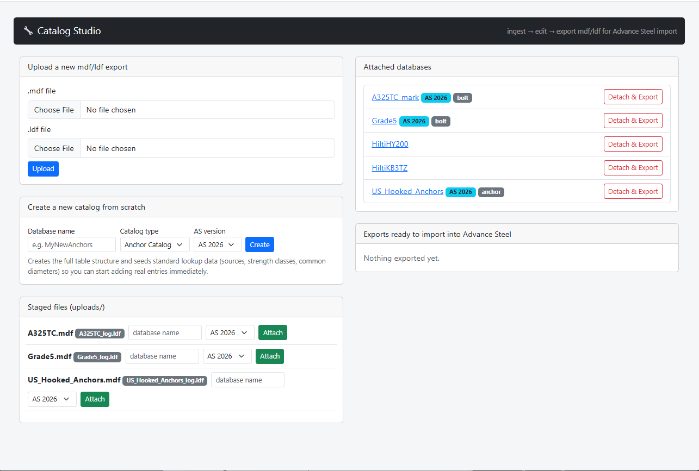
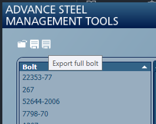
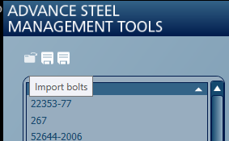
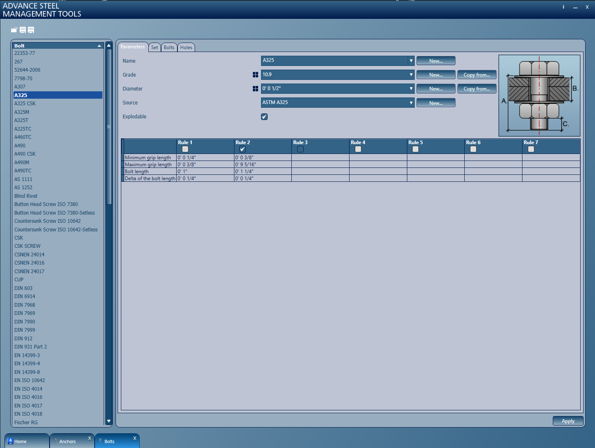
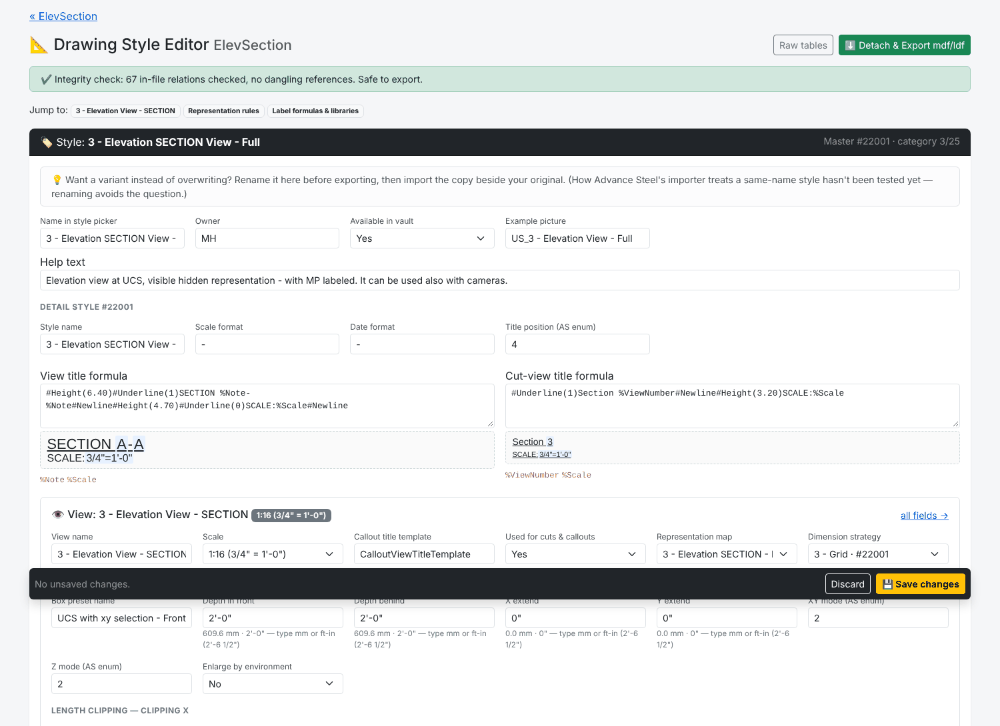
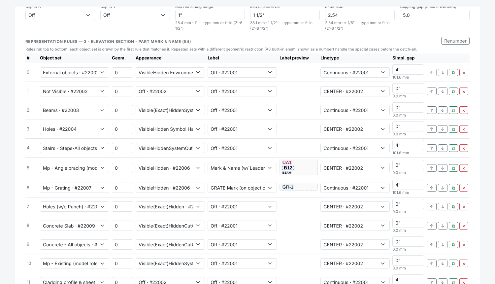
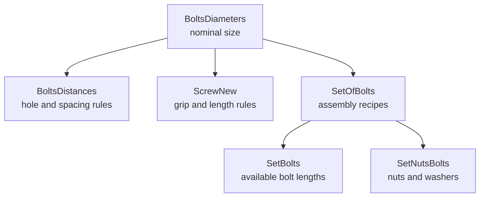

# Advance Steel Catalog Studio

> Because handling your Advance Steel bolt, anchor, and drawing-style data should be easy.

[](https://www.python.org/)
[](https://flask.palletsprojects.com/)
[](https://www.autodesk.com/products/advance-steel/overview)
[](LICENSE)

**Advance Steel Catalog Studio** is a local, browser-based workbench for inspecting, editing, repairing, creating, and exporting Autodesk Advance Steel databases stored as SQL Server `.mdf` / `.ldf` pairs: bolt and anchor component catalogs, shear-stud connector catalogs, and drawing styles exported from the Drawing Style Manager.

It replaces fragile, repetitive table-by-table editing with guided workflows that understand the relationships behind bolt diameters, bolt lengths, nuts, washers, assembly sets, grip rules, and edge distances, and behind drawing styles: view requests, representation rules, label formulas, and dimension strategies.



## Why this exists

Adding a bolt diameter to an Advance Steel catalog is not a single-row operation. A usable diameter may depend on coordinated records across six tables. Miss one relationship—or store an imperial size incorrectly—and the diameter can appear in Advance Steel while its bolts disappear, fail length calculation, or break connection joints.

Drawing styles have the same problem in a different shape. One style is a chain of linked records (style → view request → representation map → rules → appearance / label strategy → label formula), and the Drawing Style Manager makes you click through a dialog for each link. Changing what a beam label says, or how deep a section looks, means hunting through nested windows.

Catalog Studio gives those databases a safer workshop:

- Work against a disposable Docker SQL Server instead of the live Advance Steel installation.
- Upload and attach existing `.mdf` / `.ldf` catalog pairs.
- Create new bolt or anchor catalog structures from scratch.
- Browse, filter, add, duplicate, edit, and delete database records.
- Clone a working bolt diameter across its related tables.
- Preview changes before applying them.
- Detect orphaned diameter records.
- Find and replace text across database tables.
- Edit a whole drawing style on one page: view titles, scale, view depth, representation rules, label formulas.
- Check every in-file reference before export.
- Detach and export the finished database pair for Advance Steel import, or
  write a copy to `exports/` and keep editing (export a fresh copy for each
  import attempt).

## Project status

Catalog Studio is an active, early-stage workshop tool built from real Advance Steel catalog investigation.

| Area | Current status |
| --- | --- |
| Validated Advance Steel version | **2026** |
| Catalog types | Bolt, anchor, shear-stud (connector) and drawing-style exports |
| Table editor raw row operations | Implemented |
| Guided bolt-diameter cloning | Implemented |
| Bolt-set visualizer (read-only) | 3D schematic + dimensioned 2D profile implemented |
| Bolt-set assembly editor (client preview) | Phase 2 implemented, Phase 3 write-back pending |
| Anchor configurator (graphical viewer) | Implemented (read-only) |
| Anchor fabrication detail sheets | First vertical slice implemented (SVG + print) |
| Shear-stud (connector) catalogs | Auto-detected; read-only family/diameter/length browser with completeness checks and a preview-only clone proposal (write path pending schema verification) |
| Catalog health report | Implemented (read-only, per detected catalog type: bolt, anchor, shear stud, drawing style) with JSON/CSV downloads |
| Catalog comparison (`/compare`) | Implemented (read-only: table presence, row counts, diameter coverage) |
| Pre-change snapshots | Implemented for the batch writes: `COPY_ONLY` backup + manifest, explicit prune (newest N), documented manual restore |
| Delivered-library protection | Implemented (databases attached from `Astor*.mdf` are read-only) |
| Staged upload cleanup | Implemented (per-pair remove, flush, staging trash + purge) |
| CSRF protection | Every POST is checked centrally; read-only previews are the documented exceptions (`docs/csrf-audit.md`) |
| Existing catalog ingest/export | Implemented |
| New catalog scaffolding | Implemented |
| Raw table editing and filtering | Implemented (composite-key safe) |
| Drawing-style editor (Drawing Style Manager exports) | Menu-driven screens per view; style tree, representation rules (edited in place), label formulas, integrity check, schematic figures (scale, view box, clipping, dimension plan and chains), plain-language dimension request cards, read-only sub-style usage and orphan scan |
| Interface theme | Light and dark, remembered per browser; drawings stay on light paper |
| Interface assets | Bootstrap 5.3.3, htmx and Three.js vendored under `static/vendor/` (works offline); icons are inline SVG, not emoji |
| Multi-user or internet deployment | Not supported |

> [!CAUTION]
> Use copies of catalog databases and keep an untouched backup. This tool can make destructive database changes by design. It is intended for local use on a trusted machine or LAN—not exposure to the public internet.

## Quick start

### Prerequisites

- Linux, or Windows with WSL2
- Docker
- Python 3.12 or newer
- An exported Advance Steel catalog `.mdf` / `.ldf` pair if you want to modify an existing catalog

### 1. Clone and install

```bash
git clone https://github.com/meistro57/Advance_Catalog_Studio.git
cd Advance_Catalog_Studio

python3 -m venv .venv
source .venv/bin/activate
python -m pip install --upgrade pip
pip install -r catalog_studio/requirements.txt
```

### 2. Start the scratch SQL Server

Catalog Studio expects a Docker container named `hilti-scratch-sql` on `127.0.0.1:1433`. The SQL Server `sa` password must match `DB_CONFIG` in `catalog_studio/config.py`.

> [!IMPORTANT]
> **Use SQL Server 2019, not 2022 or `latest`.** Advance Steel 2026 writes and
> reads SQL Server 2019 files (internal version 904). Attaching a file to a
> newer SQL Server upgrades it permanently (2022 = 957), and Advance Steel then
> refuses the import with *"Source database is older than Release 5.1!"*.
> Catalog Studio checks the server and each file before attaching and refuses
> when the file would be upgraded.

Create the container once:

```bash
docker run -d --name hilti-scratch-sql --restart unless-stopped \
  -e ACCEPT_EULA=Y -e 'MSSQL_SA_PASSWORD=Scratch2026!Pw' \
  -p 1433:1433 mcr.microsoft.com/mssql/server:2019-latest
docker exec -u root hilti-scratch-sql mkdir -p /var/opt/mssql/attach
docker exec -u root hilti-scratch-sql chown mssql /var/opt/mssql/attach
```

Already have a 2022 container? Keep it (it holds your attached databases) and
make a 2019 one beside it under the expected name:

```bash
docker stop hilti-scratch-sql
docker rename hilti-scratch-sql hilti-scratch-sql-2022
# then the docker run command above
```

Files that were attached to the 2022 container are already upgraded and can't
go back to Advance Steel. Start again from the original Advance Steel export.

If the container already exists:

```bash
docker start hilti-scratch-sql
```

Confirm it is running:

```bash
docker ps --filter name=hilti-scratch-sql
```

Confirm it writes SQL Server 2019 files (anything but 15.x means the wrong
image, and attaches will be refused):

```bash
docker exec hilti-scratch-sql /opt/mssql-tools18/bin/sqlcmd -S localhost -U sa \
  -P 'Scratch2026!Pw' -C -Q "SELECT SERVERPROPERTY('ProductVersion') AS version"
```

If it keeps stopping after a Docker or host restart, give it a restart policy
so it comes back up on its own:

```bash
docker update --restart unless-stopped hilti-scratch-sql
```

While the container is stopped the dashboard still loads and says so; no
catalog can be attached or browsed until it is running again.

### 3. Run Catalog Studio

```bash
python catalog_studio/app.py
```

Open [http://localhost:5050](http://localhost:5050).

### Run the tests

The suite needs no SQL Server. It covers the bolt-set view model and the dimensioned
assembly profile, the shear-stud browser model and its preview-only clone proposal,
drawing-style label parsing, schematic figures and the htmx rule partials, the
fabrication sheet model, staging cleanup, connection timeouts, and route
smoke tests. It also pins the write-safety behaviour of the guided tools: the
diameter clone replaces the target before inserting, find & replace commits once
or rolls back, detach and backup always close (and detach restores multi-user
mode). The interface is pinned too: the light/dark tokens and shared design
layer, the inline SVG icon set (no colour emoji, no CDN assets), and the
drawing-style editor's menu screens. Those database tests stub the
cursor, so they check the statements and commit/rollback calls rather than a live
SQL Server:

```bash
pip install -r requirements-dev.txt   # adds pytest
python -m pytest tests/
```

The tree is also kept free of pyflakes findings; the same two commands run in
GitHub Actions (`.github/workflows/ci.yml`) on every push and pull request, so a
change that needs a database cannot silently break the suite:

```bash
pyflakes catalog_studio tests *.py
```

## Typical workflow

1. **Export or copy** the `.mdf` and `.ldf` pair: a catalog from Management Tools, or a style from the Drawing Style Manager. Never work on the live Advance Steel data directory.
2. **Upload** the pair in Catalog Studio.
3. **Attach** it to the disposable SQL Server using a clean database name. The type (bolt, anchor, shear stud, drawing style) is detected automatically.
4. **Inspect** the database: diameters and relationship warnings for catalogs, or the Drawing Style Editor and its integrity check for styles.
5. **Preview** a guided operation such as Add / Clone Diameter or Find & Replace, or make edits in the style editor.
6. **Apply** the change. Database changes run as transactions.
7. **Export a copy** (or **Detach & Export** when you are finished with the pair). "Export a copy" writes the `.mdf` / `.ldf` into `exports/` and leaves the database attached, so the loop *export → import into Advance Steel → change something → export again* does not cost you a re-attach. It takes the database offline for the few milliseconds the copy takes and brings it back online; if the copy fails the database is still brought back.
8. **Test** it in a controlled Advance Steel environment before adopting it.

Before you export, `/compare` shows what actually changed between the original export and the edited copy: tables that appeared or disappeared, row-count deltas and the diameter keys on each side.

## Advance Steel round trip

Advance Steel Management Tools already provides the two ends of the workflow: export a complete component catalog, then import the repaired or extended catalog when the work is finished.

| Export the full bolt catalog | Import the finished bolt catalog |
| --- | --- |
|  |  |

Catalog Studio operates on the `.mdf` / `.ldf` pair between those two steps. The original bolt definitions, grades, diameters, sets, holes, and automatic length rules remain visible in Advance Steel Management Tools:



Drawing styles follow the same pattern: export a style from the **Drawing Style Manager**, edit the pair in Catalog Studio, then import it back through the Drawing Style Manager. Rename the style in the editor first if you want a variant next to the original. Importing an edited style back into Advance Steel has not been tested yet (see [Safety and limitations](#safety-and-limitations)).

## What the web interface does

### Catalog dashboard

The home page is the ingest/edit/export control centre. It shows:

- uploaded catalog pairs waiting to be attached;
- per-pair **Remove** and **Clear staged uploads** actions with a staging
  trash (recoverable until an explicit purge) and confirmation counts/sizes;
- databases currently attached to the scratch SQL Server;
- Advance Steel version and type tags (bolt, anchor, shear stud, drawing style);
- new bolt and anchor catalog creation;
- completed exports ready for download, with a **Clear exports** action that
  moves them into `exports/.trash` (same recoverable-then-purge pattern) so the
  download list does not grow forever.

### Light and dark mode

A **Dark / Light** button in the navigation bar switches the interface theme. The choice is remembered in the browser (`localStorage`) and, on a first visit, follows the operating system's `prefers-color-scheme`; while no explicit choice has been made, a system change is followed live. Nothing is stored server-side.

The chrome re-themes: navigation, cards, tables, forms, alerts, badges and the drawing-style editor, including its helper panels and "changed cell" highlight. Engineering drawings deliberately stay on light "paper" in both themes - the Three.js schematic, the dimensioned bolt profile, the drawing-style schematic figures and label previews - because their strokes, dimension text and part colours are drawn for a light background. The printable fabrication sheet is always light.

Bootstrap 5.3.3's own `data-bs-theme` attribute drives the standard components; `static/css/theme.css` holds the colour tokens and the remaps for the light-only utility classes the templates use (`bg-white`, `bg-light`, `text-dark` inside `bg-light`). Bootstrap, htmx and Three.js are all vendored under `static/vendor/`, so the workbench runs with no network access, and the toolbar glyphs are inline SVG (`utils/icons.py`) rather than emoji, which render as tofu boxes on a host without a colour emoji font.

### Database overview

Opening an attached database shows every table and its live row count. Bolt and shear-stud catalogs also receive a diameter summary bar showing:

- nominal and internal millimetre values;
- related-record totals;
- orphan warnings for diameters with no working child records;
- shortcuts to the guided diameter tool and database-wide find/replace (shear-stud catalogs get the read-only stud browser instead).

Drawing-style databases show a **Drawing Style Editor** button instead of the diameter tools.

### Catalog health report

Every attached database has a **Health Report** page (`/db/<db>/health`). It aggregates the checks that already live in the per-type modules and groups the findings by area (catalog structure, diameters, hardware links, geometry, references), with an error / warning / note count and a row count for every table.

| Catalog type | What is checked |
| --- | --- |
| bolt | orphan diameters (no related rows at all) and diameters with no rows in one of the documented related tables (`SetBolts`, `SetOfBolts`, `SetNutsBolts`, `ScrewNew`, `BoltsDistances`) |
| anchor | names without any `AnchorsDefinition` length, definitions pointing at a missing anchor, hardware slots that resolve to no `SetNutsBolts` record (the configurator's own matcher), non-positive lengths/diameters and a thread longer than the rod |
| shear stud | the browser's completeness and naming findings, unchanged |
| drawing style | dangling in-file references from the style editor's integrity check, plus its structural notes |

The report is read-only: it never repairs anything, and every finding names the table it came from so it can be inspected in the raw table editor. A clean report is not a guarantee — it only means the checks this tool knows about did not fail. Existing samples show real findings (for example `Grade5` has a 10 mm diameter with no bolts and a 3/8" diameter with no nuts/washers).

The same findings download as `health.json` (the full report, including tables and sections) or `health.csv` (one row per finding: severity, area, code, table, message) from the **JSON** and **CSV** buttons on the page, for archiving a review or attaching to an issue.

### Comparing two catalogs

`/compare` (also a **Compare** button in the navigation bar) puts two attached databases side by side without changing either one:

- table presence — shared tables, tables only on one side;
- row counts per table with the delta between the two;
- diameter coverage for bolt, anchor and shear-stud catalogs: which keys exist on each side, their display names, related-row totals and orphan flags.

It answers "what changed between my original export and this repaired copy?" without detaching or re-importing anything. Only attached databases can be compared, and nothing is written.

### Add / Clone Diameter wizard

This is the relationship-aware part of Catalog Studio. The wizard lets you:

1. choose a standard imperial or metric target diameter;
2. select a known-working source diameter;
3. configure display-name replacement tokens;
4. choose which related tables to include;
5. optionally scale geometric values;
6. inspect table-by-table sample rows and counts;
7. apply the complete change atomically.

If any insert fails, the transaction rolls back rather than leaving half a diameter scattered through the catalog.

Re-applying the same target diameter is safe: the wizard replaces the existing target rows instead of duplicating them (bolt tables are cleared first, and on anchor catalogs the hole and length rows are removed before their parent anchor records). The preview shows how many existing rows will be replaced. Cloning a diameter onto itself is refused.

### Pre-change snapshots

Before a batch write (diameter clone, find & replace) Catalog Studio takes a `COPY_ONLY` backup of the scratch database inside the container and copies it to `catalog_studio/snapshots/<database>/` next to a JSON manifest. If the snapshot cannot be taken, the write does not run.

The database page lists the snapshots for that database and offers **Prune older**, which keeps the newest N (default 5) and deletes the rest — an explicit action, never automatic, because a snapshot can be hundreds of megabytes.

Restoring is a deliberate manual step, because the in-container `.bak` is removed after the copy:

```bash
docker cp catalog_studio/snapshots/<database>/<file>.bak \
  hilti-scratch-sql:/var/opt/mssql/data/<file>.bak
```

then, from `sqlcmd` or SSMS inside the container:

```sql
ALTER DATABASE [<database>] SET SINGLE_USER WITH ROLLBACK IMMEDIATE;
RESTORE DATABASE [<database>] FROM DISK = N'/var/opt/mssql/data/<file>.bak' WITH REPLACE;
ALTER DATABASE [<database>] SET MULTI_USER;
```

`snapshots.restore_plan()` produces exactly that command set for a chosen snapshot, and it is unit-tested, but the tool never runs it for you.

### Find & Replace

Searches textual columns across the database and reports matches by table and column before changing anything. This is useful when correcting catalog names, manufacturer designations, or legacy product labels. The whole replacement runs as one transaction, so a failure part-way through rolls back every column instead of leaving the catalog half changed; legacy `text`/`ntext` columns are converted on the fly because SQL Server's `REPLACE()` refuses them directly.

### Raw table editor

For work that does not fit a guided tool, each table can be browsed and filtered directly. Filters are limited to the table's own columns and to the equals / contains operators; anything else is rejected. Supported tables allow adding, editing, duplicating, and deleting rows.

Many Advance Steel tables use **composite primary keys** (`SetBolts`, `ScrewNew`, `SetNutsBolts`, `BoltsDistances`, and in style exports `DetObjReprMapItems (Key, Order)`). Rows are addressed by every key column together, and each edit/delete runs in a transaction that rolls back unless exactly one row is affected. Duplicating a composite-key row bumps the last integer key column (e.g. the next `Order` within the same `Key`).

Raw editing intentionally remains available, but relationship-dependent changes should use a guided workflow whenever possible.

### Bolt-set viewer (Phase 1 — read-only)

Bolt catalogs get a schematic Three.js visualizer that renders a selected bolt set as physical hardware: bolt head and shank, configured washers, nut, and the clamped-material grip zone. The page is built around three views of the same assembly:

- **3D schematic** — orbit/zoom, part labels on/off, perspective or orthographic, exploded slider, and click-a-part identification that highlights the matching row in the component table (and vice versa).
- **Dimensioned profile** — a flat elevation drawn from the same layout numbers: head, shank, hardware and clamped material in order, numbered balloons into a part legend, and dimensions (overall, shank under head, grip) in inches. It re-draws from the browser's preview edits, and it is the WebGL-free fallback.
- **Component table** — slot, role, side, stack order, catalogue match, and sizes.

All on-screen dimensions are shown in **inches** (the catalog stores millimetres internally, exactly as Advance Steel does). Component positions come from the catalog rows (see the verified/assumed mapping notes in `AGENTS.md`); anything unverified (the `Position`-sign side split, assumed hex heads, schematic thicknesses) stays labelled in the warnings/notes panels and in the profile footer. Nothing in the viewer writes to SQL — editing controls are a later phase.

The profile is redrawn from the browser's unsaved preview through `POST /db/<db>/bolt-set-viewer/sketch`, which re-renders the same server-side drawing from the posted layout (CSRF-checked, numbers clamped), so the 2D view and the 3D scene cannot drift apart.

### Assembly editor (Phase 2 — client-side preview)

The assembly editor at the bottom of the same page lets you experiment with a bolt set without touching the database: swap the component installed in each assembly position from the matching `SetNutsBolts` records, move components between the head side and the nut side, reorder the stack, and override the schematic clamped-material thickness. The preview re-lays out the hardware instantly and re-checks warnings (impossible stacks, missing records, grip limited by bolt length). These are local draft changes only — handing them to the server-side preview/transaction flow is Phase 3, once the `Position`-field semantics are verified.

### Anchor configurator (graphical)

Anchor catalogs get a matching schematic viewer: pick an anchor and a length variant (each `AnchorsDefinition` part), and Catalog Studio renders the rod, the thread zone, the concrete/surface plane, the nut-and-washer hardware (from `AnchorsName` → `SetNutsBolts`), and the bottom termination read from the records — plain rod, cast-in hex head, or a 90° L-hook (bend radius `HookRadius`, horizontal tail `DistanceA`). All dimensions are shown in inches; hover/click identifies each component's source record; assembled and exploded views plus a component table (the WebGL-free fallback) follow the bolt viewer's conventions. Field semantics that could not be verified offline (rod-length reference, concrete-plane placement, `Position` end grouping) are flagged as interpretation notes rather than silently assumed, exactly as with bolt `Position` values.

### Fabrication detail sheets (first vertical slice)

From the anchor configurator, any selection can open a **printable fabrication detail** (`Detail Sheet` button): a standalone, dimensioned SVG elevation (rod, thread zone, concrete plane, hardware with table references, hook/head termination) plus a fabrication-data table, hardware schedule, title block, provenance/audit block, and a prominent "NTS — USE WRITTEN DIMENSIONS" note. Dimensions come only from verified catalog fields — values that exist only as ambiguous columns are reported with their source labels and never drawn, and missing values never invent a number. Dimensions display in **imperial inches** (reduced 1/16-inch fractions with an `≈` marker for inexact conversions); metric/dual formatting helpers and their conversion tests remain for later phases. Paper sizes start with US Letter and 11 × 17 landscape. If validation finds a problem (missing/zero required fields, thread longer than the rod, no hook radius, unmatched hardware records) the sheet is watermarked **DRAFT / INCOMPLETE** and its suggested filename gains a `DRAFT_` prefix. PDF output currently uses the browser's Print / Save as PDF (vector, selectable text); server-side PDF generation and additional anchor shapes are later phases. The first supported family — `US_Hooked_Anchors` — and its exact field mapping are documented in `catalog_studio/utils/fabrication.py`.

### Drawing-style editor

Exports from the **Drawing Style Manager** (also `.mdf` / `.ldf`) are detected as `drawing style` and get a one-page editor at `/db/<db>/drawing-style` instead of the Style Manager's nested dialogs:

- **Menu screens** — a sticky menu lists the style, each view, its representation rules and its dimensions, then the shared libraries and the help page. One screen is shown at a time (the URL hash names it, prev/next walk the list), so a style with many views stays navigable instead of being one endless page.
- **Style identity** — picker name, help text, owner, title and cut-view title formulas with a live rendered preview.
- **Each view** — scale (shown as `1:16 (3/4" = 1'-0")`), representation map, dimension strategy, view-box depth, length clipping. Lengths display in feet-inches and accept either mm or ft-in (`2'-6 1/2"`).
- **Dimension setup** — every request row shows its point count and names, its axis and Above flag, and the file's own AS switches (global arrangement, grouping, combine, auto-separate, group number, label formula) as labelled badges with an "all fields" link.
- **In-place rule edits** — move / copy / delete / renumber swap only that view's rules block (htmx, vendored locally) instead of reloading the page, so a long style keeps its scroll position. The block is scoped to the view, so two views that share one representation map edit independently; saving fields posts in the background and reports through the page's flash area. Both paths still work without JavaScript, and the no-JS fallback returns to the rules screen of the view that sent the action.
- **Pictures of the numbers** — a style-level overview comparing how large each view prints, then per view a print-scale ruler, a view-box plan/section showing X/Y reach and front/behind depth, a length-clipping diagram naming each distance, and a dimension section with a "how to read a chain" explainer, a plan of every chain in the view (X chains above/below the part, Y chains beside it, numbered into a legend), and a chain sketch per request (collapsed behind a summary once a view has more than six). Each chain keeps one colour across the page: the number on its card is the colour of its lane in the plan and of its legend swatch, so the card and the picture are obviously the same chain. They redraw as you edit and each one states which readings are still unverified; they are schematics built from the row values, not Advance Steel's own output.
- **Representation rules** — a precedence ladder (first matching rule wins) above the editable rows, with dropdowns for object set, appearance, label strategy and linetype, the label each rule prints, and move up / move down / copy below / delete.
- **Libraries** — label formulas (live preview plus a click-to-insert token palette, with the token set and the `%%c` / `%%d` / `%%p` symbol escapes documented by Autodesk's style guide), label strategies, appearances with hatch swatches drawn at the preset's angle, object sets and their model roles. Each library is its own menu screen rather than a tab strip, so it is reachable directly by hash and never pushes the style content down the page.
- **Integrity check** — every in-file reference is checked before you export.
- **Sub-style usage** — a read-only "used by" page lists every drawing style that depends on a shared record (appearance, label formula, qualifier set, dimension setup) with the chain that connects them, plus the rows no style reaches.





Dropdowns come from the export's own `InfoTableRelations` table (Autodesk's column → lookup map) plus a few verified fixes. References to Autodesk's built-in databases aren't in the export, so those stay as raw numbers rather than guessed labels. Schema notes: [`docs/drawing-style-schema.md`](docs/drawing-style-schema.md).

Label formulas use Advance Steel's token syntax:

| Token | Meaning |
| --- | --- |
| `%Field` | model property, e.g. `%Position`, `%Name`, `%MainPartPosNum`, `%BoltCount`, `%Note`, `%Scale` |
| `#Newline` | line break |
| `#Height(mm)` | text height |
| `#Bold(0/1)`, `#Underline(0/1)`, `#Italic(0/1)`, `#Color(ACI)` | styling |
| `#Rounded`, `#Rectangle`, `#Frame`, `#Circle`, `#Box` … `#End` | framed text |

The preview fills fields with sample values (`%Position` → `b104`), so `#Rounded%Position#End#Newline#Height(3.20)%Name` previews as a framed mark over the part name.

To make a variant rather than overwrite a style, rename it before exporting. Unsaved edits are highlighted, and the save bar counts them; rule moves, copies and deletes apply immediately.

### Sub-style usage and orphan scan

The Style Manager hides a real hazard: appearances, label formulas, qualifier sets and dimension setups are shared library rows, and one edit changes every style that uses them. The export also renumbers all keys into one range (`22001`, `22002`, ...), so the links are invisible in the SQL tables.

`/db/<db>/drawing-style/usage` (button: **Sub-style usage**) answers both halves:

- **Referenced by** — pick a shared table and a record; the page lists every `DetailStyle` that reaches it through the containment chain (view request → representation map → rule → appearance/label strategy, or view request → dimension strategy → dimension item → point selection), with the picker name, owner and category numbers, and a hop-by-hop path. When more than one style depends on the record it says so up front.
- **Rows no drawing style reaches** — every row in the style tables that is unreachable from all `DetailStyle` rows, grouped by table with examples. In the checked-in samples this is a single unused grid-reference setting; it is a review prompt, not a delete list.

The chain is declared in `utils/style_usage.py` (`ASCENT_EDGES`) from the verified export shape, because the export's `InfoTableRelations` map states references but not which side contains which. Category values are Advance Steel built-in enums, shown as numbers because their labels are not in the export. Nothing is written, deduplicated, purged or compacted.

Autodesk's own Drawing Style Manager guide confirms the model and the two copy modes: **Copy** reuses the original sub-styles, **Deep copy** duplicates every level (prefixing each copy with `Copy of`). DSM's **Compact database** button already merges equal records and rewires references, so this page reports unreachable rows instead of duplicating that operation; run Compact in the Style Manager on a copy after reviewing the report.

### Shear-stud (connector) browser

Catalogs that carry the `Connector*` tables (currently the Nelson H4L export) are detected as `shear stud` and get a **read-only** browser at `/db/<db>/shear-stud-browser`:

- **Families and lengths** — one card per family, one table per grade, one row per diameter with the authored `ConnectorDiameters.RunName`, the hole/spacing rule from `ConnectorDistances`, and every stud length as a chip (clicking one filters the stud table to that length).
- **Studs** — family, grade, diameter, length, display name, head diameter × height with round or n-sided head, weight and the raw `SetBolts.Type`, with a status column carrying the validation findings for each record.
- **Validation** — the documented minimum record set is checked per (family, grade, diameter): lookup rows, `ConnectorDiameters`, `ConnectorDistances`, `ConnectorRelations`, and at least one stud length. Orphan lookups, duplicate relations or stud rows, head diameter not larger than the shank, broken names and non-canonical diameter display strings are reported as error / warning / note rather than repaired.
- **Traceability** — every friendly value links back to its raw table, filtered to the matching record (for example `SetBolts` by diameter, or `ConnectorRelations` by connector diameter).
- **Units** — a `mm` / `inch` toggle switches every displayed dimension (diameters, lengths, hole rules, head geometry) without touching the stored millimetre values; inches reuse the fabrication-sheet convention (nearest 1/16 in, reduced fraction, `≈` when the millimetre value is not exactly representable). Filter links and the clone form carry the choice, while the clone proposal table keeps showing the values as they would be stored.
- **Clone proposal (preview only)** — a "Plan a clone" form takes a source family/grade/diameter plus a target diameter and free-form length list, then renders the INSERT-shaped rows it *would* need in `ConnectorDiameters`, `ConnectorDistances`, `ConnectorRelations` and `SetBolts`. Optionally it scales head geometry, weight and the hole rule by the diameter ratio and says so; blank along/across fields fall back to the (scaled) source rule. Duplicate diameters, lengths, names and relation keys, incomplete sources, non-numeric input and tight spacing are reported as issues that block the plan. There is **no apply action** — the proposal is a review artifact for the eventual write path.

The page never writes to the catalog. Field meanings are **observed** from a single export and not yet round-trip verified through Advance Steel 2026, so editing, cloning and the relation-key rule stay out of scope until that verification is done. Schema notes: [`docs/shear-stud-schema.md`](docs/shear-stud-schema.md).

## Why bolt diameters are difficult

Advance Steel stores internal geometry in **millimetres**, even when the catalog displays imperial fractions.

| Nominal size | Stored value | Typical `RunName` |
| ---: | ---: | --- |
| 1/4 in | `6.35` | `' 1/4 inch'` |
| 3/8 in | `9.525` | `' 3/8 inch'` |
| 1/2 in | `12.7` | `' 1/2 inch'` |
| 5/8 in | `15.875` | `' 5/8 inch'` |
| 3/4 in | `19.05` | `' 3/4 inch'` |
| 7/8 in | `22.225` | `' 7/8 inch'` |
| 1 in | `25.4` | `' 1 inch'` |
| 1 1/4 in | `31.75` | `' 1 1/4 inch'` |
| 1 1/2 in | `38.1` | `' 1 1/2 inch'` |

The leading space in values such as `' 3/8 inch'` is deliberate and follows observed Advance Steel catalog formatting.

### The six-table bolt relationship



| Table | Role in the catalog |
| --- | --- |
| `BoltsDiameters` | Available nominal diameters and Advance Steel display names |
| `BoltsDistances` | Hole tolerances plus along/across spacing values |
| `ScrewNew` | Grip bands and automatic bolt-length calculation rules |
| `SetOfBolts` | Assembly recipes connecting bolts, nuts, and washers |
| `SetNutsBolts` | Physical nut and washer records |
| `SetBolts` | Purchasable bolt lengths, head geometry, names, and weights |

A row added only to `BoltsDiameters` is therefore just a label. Without matching child records, it is not a functioning bolt family.

## Cloning and scaling

When cloning from a source diameter, Catalog Studio can calculate a diameter ratio:

```text
scale ratio = target diameter / source diameter
```

It can apply that ratio to selected linear dimensions and use the squared ratio for component weights. Name replacement is context-aware so changing a 1-inch diameter token does not also corrupt a 1 1/4-inch bolt length.

> [!IMPORTANT]
> Scaled geometry and weight are generated starting values, not certified product data. Validate head dimensions, nut and washer geometry, grip rules, weights, clearances, and spacing against the governing standard and manufacturer data before production use.

## Example repair result

The original development case repaired an `A325TC_mark` catalog by replacing an orphaned/miskeyed diameter with a complete 3/8-inch family:

- `BoltsDiameters`: one correct `9.525` mm entry;
- `BoltsDistances`: three tolerance rows;
- `ScrewNew`: three assembly calculation rows;
- `SetOfBolts`: three assembly definitions;
- `SetNutsBolts`: matching nut and washer components;
- `SetBolts`: 37 bolt lengths from 1 to 10 inches.

The joined export produced 1,071 bolt-assembly records with matching nut and washer data. That investigation became the basis of the cascading diameter engine.

## Command-line utilities

The repository also includes small inspection and export tools for development and diagnostics.

| Utility | Purpose |
| --- | --- |
| `db_inspect.py` | List tables, columns, row counts, and sample records |
| `inspect_schema.py` | Inspect the known anchor catalog schema |
| `diagnose_sets.py` | Inspect bolt assembly-set bindings |
| `export_bolts.py` | Export joined bolt and nut records to CSV |
| `export_catalog.py` | Export and normalise joined anchor catalog records |
| `explore_hilti.py` | Explore the attached Hilti catalog database |

Examples:

```bash
python db_inspect.py A325TC_mark
python export_bolts.py A325TC_mark output_catalog.csv
python export_catalog.py HiltiHY200 output_anchor_catalog.csv
```

## Project structure

```text
Advance_Catalog_Studio/
├── catalog_studio/
│   ├── app.py                 # Flask routes and application entry point
│   ├── config.py              # Local paths, SQL connection, and AS version
│   ├── templates/             # Browser interface
│   ├── static/
│   │   ├── js/bolt-set-viewer.js   # Three.js bolt-set visualizer + editor
│   │   ├── js/bolt-set-layout.js   # Client mirror of the bolt layout math
│   │   ├── js/anchor-configurator.js # Three.js anchor viewer
│   │   ├── js/theme.js            # Light/dark toggle (persistence, icons)
│   │   ├── css/theme.css          # Design tokens, tables, chips, Bootstrap remaps
│   │   ├── css/                   # bolt-set-viewer.css, fabrication-sheet.css
│   │   ├── img/                   # Brand mark + SVG favicon
│   │   └── vendor/
│   │       ├── bootstrap/          # Pinned local Bootstrap 5.3.3 (offline)
│   │       ├── three/              # Pinned local Three.js r160 (offline)
│   │       └── htmx/               # Pinned htmx 2.0.4 (offline partial updates)
│   └── utils/
│       ├── anchor_sets.py      # Anchor view model for the configurator
│       ├── icons.py            # Inline SVG icon set for the chrome
│       ├── bolt_sets.py        # Bolt-set view model for the viewer
│       ├── bolt_profile.py     # Dimensioned 2D assembly profile (SVG)
│       ├── fabrication.py      # Detail-sheet model: dims, validation, SVG
│       ├── drawing_styles.py   # Drawing-style tree, label parsing, relations
│       ├── style_diagrams.py   # Schematic SVG figures for drawing styles
│       ├── style_usage.py      # Reverse references (used-by) and orphan scan
│       ├── shear_studs.py      # Shear-stud (connector) browser model
│       ├── snapshots.py        # COPY_ONLY .bak snapshots, retention, restore plan
│       ├── compare.py          # Read-only comparison of two attached catalogs

│       ├── health.py          # Cross-type read-only health report
│       ├── db.py               # SQL inspection, composite-key-safe row ops, catalog operations
│       ├── docker_ops.py       # File transfer to/from scratch SQL Server
│       ├── metadata.py         # Catalog type/version metadata
│       ├── schema_templates.py # New bolt and anchor database templates
│       ├── staging.py          # Upload/export file pairing
│       └── staging_cleanup.py  # Safe removal of staged uploads
├── tests/                     # Pytest: models, SVG figures, routes (no DB needed)
├── samples/                   # Example mdf/ldf catalog pairs (tracked)
├── .github/workflows/ci.yml   # Tests + lint on push/PR (no database needed)
├── docs/
│   ├── images/
│   ├── csrf-audit.md          # Every route: writes, CSRF handling, exemptions
│   ├── drawing-style-schema.md # Drawing Style Manager export investigation
│   └── shear-stud-schema.md   # Nelson H4L connector catalog investigation
├── db_inspect.py
├── diagnose_sets.py
├── export_bolts.py
├── export_catalog.py
└── inspect_schema.py
```

## Planned features

The long-term goal is to make catalog editing resemble the hardware being configured—not the SQL schema hiding underneath it.

### Graphical bolt-set builder

> Status: the read-only visualizer (Phase 1) and the client-side assembly editor (Phase 2) described in the sections above are implemented. Remaining work under issue #1 is verifying the `Position`-field semantics against a live catalog and wiring draft proposals into the server-side preview and transaction flow (Phase 3). The list below is the roadmap for that final phase.

A visual assembly editor is planned for adjusting complete bolt sets without manually tracing `SetOfBolts`, `SetNutsBolts`, `SetBolts`, and `ScrewNew` records.

Planned capabilities include:

- an exploded bolt-stack view showing the bolt head, connected parts, nut, and each washer;
- clear control over component order, side, orientation, and assembly position;
- live grip-stack and available-length feedback;
- direct selection of bolt, nut, washer, grade, material, and set type;
- warnings for missing components, impossible combinations, and broken diameter links;
- a database-change preview before the adjusted set is committed.

The aim is simple: select and adjust the physical bolt assembly on screen, then let Catalog Studio maintain the related database records.

### Anchor configuration that makes sense

> Status: a graphical, read-only anchor viewer is implemented (see the Anchor configurator section above) and exercises the same rendering patterns as the bolt viewer. The purpose-built *editing* interface described below remains planned; it depends on verifying the anchor `Position` semantics against a live catalog first, in the same way the bolt-set editor does.

Anchor catalogs need a purpose-built interface rather than a generic form containing dozens of disconnected fields. The planned anchor configurator will organise data around the actual anchor and its installation geometry.

Planned views include:

- a labelled anchor diagram with diameter, overall length, thread length, embedment, top distance, and other relevant dimensions;
- logical sections for anchor identity, material and strength, geometry, holes, nuts, washers, and installation rules;
- hardware-stack previews showing which nut and washer records are attached;
- guided configuration for supported anchor families instead of direct foreign-key entry;
- immediate relationship and completeness checks;
- a final "what Advance Steel will receive" preview before saving.

### Drawing styles

Next steps for the drawing-style editor:

- confirm that an edited style imports cleanly through the Drawing Style Manager, and how same-name styles are handled;
- clone a whole style inside one export, so several variants can ship in one file;
- edit dimension point selections and arranger strategies with the same dropdowns;
- label the Advance Steel built-in values (geometric restrictions, object qualifiers, box modes) once they are verified against a live install;
- styles that use detail processes (`DetailProcess*` tables, empty in the first sample);
- selective deep-copy of a style branch: the guide confirms DSM's two modes (Copy shares sub-styles, Deep copy duplicates every level and prefixes each with `Copy of`), so a selective branch is a third mode whose keys and import behaviour still need a verified round trip;
- batch presentation replacement across styles: a write path that also needs the round trip, and it should reuse the sub-style usage report to warn about shared records;
- purging orphan rows: the tool reports unreachable rows but does not delete them, because a purged export has not been round-trip verified and the `.mdf` / `.ldf` pair must stay consistent for import;
- compaction: use the Drawing Style Manager's own **Compact database** function (it merges equal records and rewires references); Catalog Studio does not duplicate it.

### Catalog intelligence and comparison

Later releases may also add:

- a visual relationship map for any selected catalog component;
- full-catalog health checks and repair suggestions;
- side-by-side comparison of two catalog databases;
- reusable manufacturer/standard templates;
- change history, export reports, and reversible editing sessions;
- additional Advance Steel versions as their schema differences are verified.

These are planned features, not claims about the current release. Development will remain driven by verified Advance Steel behaviour and real catalog test cases.

## Safety and limitations

- Never point the tool at your live Advance Steel installation databases.
- Always retain the untouched source `.mdf` / `.ldf` pair.
- Test exported catalogs before rolling them into a working environment.
- SQL identifiers are handled separately from values; future catalog schemas still require validation.
- Only Advance Steel 2026 has been tested so far.
- Drawing-style round trips (edit → export → Drawing Style Manager import) have been verified at the SQL level only; test imports on a copy of your style library first.
- The Flask development server has no authentication or multi-user protections. Destructive cleanup actions require a CSRF token and are limited to files inside the runtime `catalog_studio/uploads/` staging area (removal moves files to `uploads/.trash`; attached databases, container files, exports, and the `samples/` examples are never touched).
- Catalog schemas can differ between Advance Steel versions and component families.
- The drawing-style usage page only reads. Purging orphan rows, deduplicating records with key remapping, cloning style branches and compacting/shrinking the database are **not** implemented: those write paths have not been round-trip verified, and deleting the `_log.ldf` would break the `.mdf` / `.ldf` pair Advance Steel imports.
- If detaching a database fails, Catalog Studio restores it to multi-user mode so it can still be reconnected. A database stuck in `RECOVERY_PENDING` ("Access is denied" on its files) can neither be detached nor brought online: restart the container, and if it survives that, `DROP DATABASE` it and re-attach from its own `.mdf` / `.ldf` copy. Each database now gets its own files (`<db>.mdf` / `<db>_log.ldf`), so two databases can no longer share one `mdf` — the cause of that state.
- Databases attached from a delivered Advance Steel library file (`AstorDetails.mdf`, `AstorBase.mdf`, `AstorAddIn.mdf`, `AstorSettings.mdf`) are recorded as such and kept **read-only**: every write route refuses them with an explanation. Attach a copy under a new database name to edit it.
- Every request that can change something (uploads, attach, create, detach, clone, find & replace, row CRUD, style edits, snapshot pruning) requires a session CSRF token; the central guard and the full route list are in `docs/csrf-audit.md`.
- Snapshot pruning is manual and keeps the newest five by default; restoring a snapshot is a documented `docker cp` + `RESTORE DATABASE ... WITH REPLACE` step, never automatic.
- Batch writes take a **pre-change snapshot** first: the bolt-diameter clone and database-wide find & replace run `BACKUP DATABASE ... WITH COPY_ONLY` inside the scratch container and copy the `.bak` to `catalog_studio/snapshots/<database>/` with a JSON manifest. If the snapshot fails, the change is not attempted. Snapshots are runtime files and are git-ignored.

## Contributing

Catalog knowledge is the valuable bit. Bug reports, confirmed schema differences, reproducible catalog cases, and tested improvements are welcome through [GitHub Issues](https://github.com/meistro57/Advance_Catalog_Studio/issues); the navigation bar carries an **Issues** link to the same page so a problem can be filed straight from the tool.

When reporting a problem, include the Advance Steel version, catalog type, operation performed, expected result, and the relevant schema or error output. Do not attach customer data or live production databases.

## Licence and trademark notice

The source code is released under the [MIT License](LICENSE).

Advance Steel and Autodesk are trademarks of Autodesk, Inc. This is an independent community project and is not affiliated with or endorsed by Autodesk.
